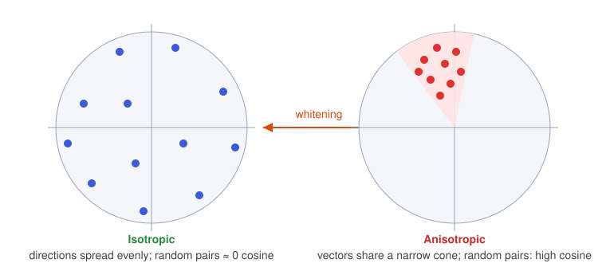

Embeddings are used through geometry: nearest neighbours, clusters, cosine scores. That only works if the geometry is well behaved. This article explains one specific way it often is not (**anisotropy**), what the research found about it in popular models, and a simple linear fix (**whitening**) with its dimensionality-reduction variant.

It builds on [From Token IDs to Vectors](../embeddings-token-vectors/index.qmd), which introduced embeddings and cosine similarity. The algebra behind the whitening matrix is in a [companion derivation page](derivation.qmd).

## What cosine similarity quietly assumes

Cosine similarity compares directions:

$$
\cos(\mathbf{x}, \mathbf{y}) = \frac{\sum_{i=1}^{d} x_i y_i}{\sqrt{\sum_{i=1}^{d} x_i^2}\,\sqrt{\sum_{i=1}^{d} y_i^2}}
$$

where $x_i, y_i$ are the coordinates of the two vectors and $d$ is the dimension. The formula is written in terms of *coordinates*, so it measures a geometric angle only if the coordinate axes are a **standard orthonormal basis** (perpendicular, unit length). Su et al. (2021) use this as a heuristic motivation: if a set of vectors is *isotropic*, it is reasonable to treat the axes as a good orthonormal basis and trust the formula; if it is not, transform it first and then take cosines. This is a motivating argument and the paper backs it with experiments.

### Why non-orthonormal axes break the formula

Suppose our embedding coordinates $(x_1, x_2)$ and $(y_1, y_2)$ are measured along two basis vectors $\mathbf{b}_1, \mathbf{b}_2$ that are neither perpendicular nor unit-length:

$$
\mathbf{x} = x_1 \mathbf{b}_1 + x_2 \mathbf{b}_2, \qquad \mathbf{y} = y_1 \mathbf{b}_1 + y_2 \mathbf{b}_2
$$

Taking the true geometric inner product $\langle \mathbf{x}, \mathbf{y} \rangle$ expands into four terms, collected by the **Gram matrix** $\mathbf{G}_{ij} = \langle \mathbf{b}_i, \mathbf{b}_j \rangle$:

$$
\langle \mathbf{x}, \mathbf{y} \rangle = x_1 y_1 \|\mathbf{b}_1\|^2 + x_2 y_2 \|\mathbf{b}_2\|^2 + (x_1 y_2 + x_2 y_1)\langle \mathbf{b}_1, \mathbf{b}_2 \rangle = \mathbf{x}^\top \mathbf{G} \mathbf{y}
$$

The standard cosine formula $\frac{\sum x_i y_i}{\|\mathbf{x}\|\|\mathbf{y}\|}$ silently assumes $\|\mathbf{b}_1\| = \|\mathbf{b}_2\| = 1$ and $\langle \mathbf{b}_1, \mathbf{b}_2 \rangle = 0$ (i.e., $\mathbf{G} = \mathbf{I}$). When the embedding space is anisotropic, meaning it is stretched along certain directions ($\|\mathbf{b}_i\| \neq 1$) or correlated across dimensions ($\langle \mathbf{b}_1, \mathbf{b}_2 \rangle \neq 0$), the naive coordinate sum drops the cross-terms and misweights the axes. 

This is why Su et al. (2021) apply a whitening transformation $\tilde{\mathbf{x}} = (\mathbf{x} - \boldsymbol{\mu})\mathbf{W}$ before computing cosine similarity: whitening forces the empirical covariance to the identity matrix, effectively rotating and rescaling the coordinate axes back into an orthonormal basis where $\mathbf{G} = \mathbf{I}$.

## Isotropic vs anisotropic

A set of vectors is **isotropic** if its directions are spread uniformly, with no preferred direction. A practical test (used by Ethayarajh, 2019, following Arora et al., 2017): the **average cosine similarity between randomly sampled pairs**. For an isotropic set it is about 0. The closer it is to 1, the more **anisotropic** the set, which geometrically means the vectors sit in a **narrow cone**.

{fig-alt="Left: points spread evenly around a circle, labelled isotropic. Right: points clustered in a narrow cone, labelled anisotropic. An arrow labelled whitening points from right to left."}

There are two ingredients that make a cloud of vectors look like that cone:

1. A **shared offset**: all vectors have a large common component (a non-zero mean $\boldsymbol{\mu}$).
2. **Unequal spread**: a few directions have much more variance than the rest. Instead of forming a round sphere, the cloud is stretched into a long cigar (ellipsoid). For example, if the first coordinate typically ranges around $\pm 100$ while the other $767$ coordinates range around $\pm 0.1$, that single high-variance axis dominates $\sum x_i y_i$, effectively reducing a $768$-dimensional comparison to a $1$-dimensional check.

Whitening, as we will see, targets both.

## What the evidence says: Ethayarajh (2019)

Ethayarajh studied hidden-layer representations (not just the input embedding table) of **ELMo** (2 layers), **BERT-base-cased** and **GPT-2** (12 layers each), plus each model's input layer as "layer 0". Input sentences came from the SemEval Semantic Textual Similarity tasks (2012 to 2016), and only words appearing in at least 5 distinct contexts were analysed.

**Finding 1: anisotropy is everywhere.** In all layers of all three models, average cosine between random words is clearly above 0 (the one exception is ELMo's input layer, since it generates character-level embeddings without using context). It is generally larger in higher layers. For GPT-2 it is roughly 0.6 in layers 2 to 8 and then climbs; in the last layer, two random words have an average cosine similarity that is almost 1. BERT also generally rises with depth, but with an exception: its penultimate layer is noticeably more anisotropic than its last. (Approximate values here are read off the paper's Figure 1.)

**Finding 2: upper layers are more context-specific.** Define, for a word $w$ occurring in $n$ contexts, its **self-similarity** in layer $\ell$:

$$
\text{SelfSim}_\ell(w) = \frac{1}{n^2 - n} \sum_{j} \sum_{k \ne j} \cos\big(f_\ell(s_j, i_j),\, f_\ell(s_k, i_k)\big)
$$

Here $f_\ell(s, i)$ is the layer-$\ell$ representation of the word at position $i$ in sentence $s$, so this is the average cosine between the word's vectors across different contexts. A value of 1 means no context-specificity. Because anisotropy inflates every cosine, the paper subtracts a **baseline** (the average cosine of random words in that layer):

$$
\text{SelfSim}^*_\ell(w) = \text{SelfSim}_\ell(w) - \text{Baseline}(f_\ell)
$$

After that adjustment, self-similarity drops as layers go up, so representations become more context-specific. Anisotropy and context-specificity grow together; the paper suggests anisotropy is inherent to, or at least a by-product of, contextualization.

**Finding 3: context-specificity looks different per model.** Using intra-sentence similarity (how close the words in one sentence are to their mean vector), words in the same sentence grow more similar in higher ELMo layers, grow more dissimilar in BERT (while staying more similar than random words), and in GPT-2 are about as similar to each other as random words.

**Finding 4: a single static vector explains little.** The **maximum explainable variance** of a word is the fraction of variance in its contextualized vectors explained by their first principal component:

$$
\text{MEV}_\ell(w) = \frac{\sigma_1^2}{\sum_i \sigma_i^2}
$$

where $\sigma_1 \ge \sigma_2 \ge \dots$ are the singular values of the matrix whose rows are the word's vectors across contexts. It is the best case for replacing all of a word's contextual vectors with one fixed vector. After subtracting the anisotropy baseline, on average less than 5% of the variance is explained in any layer of any model. Even so, the first principal component of a word's vectors from the lower layers makes a static embedding that beats GloVe and FastText on many word-similarity benchmarks.

The paper leaves open whether making contextual representations more isotropic (for example with a penalty added to the training objective) would help.

## Why a cone hurts similarity search

Write each vector as the shared offset plus a residual: $\mathbf{x} = \boldsymbol{\mu} + \mathbf{a}$, $\mathbf{y} = \boldsymbol{\mu} + \mathbf{b}$. Then

$$
\mathbf{x}\cdot\mathbf{y} = \lVert\boldsymbol{\mu}\rVert^2 + \boldsymbol{\mu}\cdot(\mathbf{a}+\mathbf{b}) + \mathbf{a}\cdot\mathbf{b}.
$$

The informative part, how $\mathbf{a}$ and $\mathbf{b}$ relate, is the last term. When $\lVert\boldsymbol{\mu}\rVert$ is large, the first term dominates and every pair scores near 1: the meaningful differences are squeezed into a tiny range at the top of the scale. That makes scores fragile to noise and awkward to threshold. A fixed cutoff such as "keep results above 0.9" does not repair it, because what moved is the whole scale, not just where you cut it. Similarly, a few very-high-variance directions that carry non-semantic signal can dominate the dot product. Li et al. (2020), cited by Su et al., report for BERT sentence embeddings that word frequency biases the space.

To be precise about the claim: a narrow cone does not mathematically force the ranking to flip. If $\boldsymbol{\mu}\cdot(\mathbf{a}+\mathbf{b})$ were zero and the residuals had uniform norm and no noisy dominant directions, the $\lVert\boldsymbol{\mu}\rVert^2$ term would just shift the dot product by a constant (and compress cosine similarity monotonically toward 1) without changing which pair is higher. The problem is that real embeddings are not that clean. The empirical evidence shows that raw BERT sentence embeddings compared with cosine do poorly on similarity benchmarks, and removing the anisotropy improves them (numbers below).

## Whitening

**Goal:** transform the vectors so that their **mean is 0** and their **covariance matrix is the identity** matrix $\mathbf{I}$ (every direction has variance 1, and no direction is correlated with another). That is what a standard normal distribution looks like.

### Intuition in two dimensions

Picture the points as a tilted, stretched ellipse.

1. **Centre it**: subtract the mean $\boldsymbol{\mu}$ so the cloud is around the origin (removes the shared offset).
2. **Rotate it**: rotate the axes to line up with the ellipse (this is what the eigenvectors $\mathbf{U}$ of the covariance do). Now the coordinates are uncorrelated.
3. **Rescale it**: squash the long axis and stretch the short one so every axis has variance 1 (divide each by the square root of its variance, $\boldsymbol{\Lambda}^{-1/2}$). The ellipse becomes a circle.

```{mermaid}
flowchart LR
    X["<b>Embeddings</b><br/>x ∈ ℝ<sup>d</sup><br/>N vectors"] --> M["<b>Centre</b><br/>x − μ"]
    M --> R["<b>Rotate to principal axes</b><br/>(x − μ) U"]
    R --> S["<b>Rescale each axis</b><br/>(x − μ) U Λ<sup>−1/2</sup><br/>divide axis j by √λⱼ"]
    S --> Z["<b>Whitened</b><br/>x̃ = (x − μ) W<br/>mean 0, covariance I"]
    S -. "keep first k columns of W" .-> K["<b>Whitening-k</b><br/>x̃ ∈ ℝ<sup>k</sup>, k < d"]
```

### The formulas

Using the notation of Su et al. (row vectors; $N$ embeddings $\mathbf{x}_i \in \mathbb{R}^{1\times d}$):

$$
\boldsymbol{\mu} = \frac{1}{N}\sum_{i=1}^{N}\mathbf{x}_i, \qquad
\boldsymbol{\Sigma} = \frac{1}{N}\sum_{i=1}^{N}(\mathbf{x}_i-\boldsymbol{\mu})^\top(\mathbf{x}_i-\boldsymbol{\mu})
$$

$$
\boldsymbol{\Sigma} = \mathbf{U}\boldsymbol{\Lambda}\mathbf{U}^\top \quad\text{(SVD / eigendecomposition)}, \qquad
\mathbf{W} = \mathbf{U}\boldsymbol{\Lambda}^{-1/2}, \qquad
\tilde{\mathbf{x}}_i = (\mathbf{x}_i - \boldsymbol{\mu})\,\mathbf{W}
$$

Every symbol:

- $\boldsymbol{\mu}\in\mathbb{R}^{1\times d}$: the mean embedding. Subtracting it centres the data.
- $\boldsymbol{\Sigma}\in\mathbb{R}^{d\times d}$: the covariance matrix; entry $(j,k)$ says how coordinates $j$ and $k$ vary together (basically variance of $\mathbf{x}_j$ and $\mathbf{x}_k$).
- $\mathbf{U}$: an orthogonal matrix whose columns are the principal directions (it rotates without stretching, so it preserves distances).
- $\boldsymbol{\Lambda}$: a diagonal matrix of variances $\lambda_1\ge\lambda_2\ge\dots\ge\lambda_d>0$ along those directions.
- $\boldsymbol{\Lambda}^{-1/2}$: the diagonal matrix with entries $1/\sqrt{\lambda_j}$, i.e. "divide each axis by its standard deviation".
- $\mathbf{W}$: the single $d\times d$ matrix that does rotate-and-rescale; applying it is one matrix multiply.

In column-vector notation (used in some textbooks), the same transform reads $\tilde{\mathbf{h}} = \boldsymbol{\Lambda}^{-1/2}\mathbf{U}^\top(\mathbf{h}-\boldsymbol{\mu})$; it is the transpose of the row form.

The check that this gives identity covariance is two lines of algebra; see the [derivation page](derivation.qmd). A tiny example: if $\boldsymbol{\Sigma}=\text{diag}(4, 1)$ then $\mathbf{U}=\mathbf{I}$, $\mathbf{W}=\text{diag}(1/2, 1)$, so the first coordinate is halved (its standard deviation was 2) and the second is left alone: both now have variance 1.

### Whitening-$k$: shrinking the vectors

The values $\lambda_j$ are sorted from largest to smallest. A direction with tiny $\lambda_j$ barely varies, so it carries little information. Keeping only the **first $k$ columns** of $\mathbf{W}$ gives vectors in $\mathbb{R}^{k}$:

$$
\tilde{\mathbf{x}}_i = (\mathbf{x}_i-\boldsymbol{\mu})\,\mathbf{W}[:, :k]
$$

This is equivalent to PCA (keep the top directions) followed by the per-axis rescaling. Su et al. call it **Whitening-$k$**. Because the cost of comparing two vectors grows with their dimension, a smaller $k$ also means smaller storage and cheaper similarity computation (the paper motivates the faster-retrieval claim this way). $k$ is a hyperparameter: for most of their tasks, cutting to about a third of the original dimension was near the best.

### What it costs

You need $\boldsymbol{\mu}$ ($1\times d$) and $\boldsymbol{\Sigma}$ ($d\times d$) from a representative corpus of $N$ vectors, a one-time computation of $O(N\cdot d^2)$. Both can be accumulated incrementally in a single streaming pass (without storing the vectors); the memory needed does not grow with $N$. At query time whitening is one matrix multiply per vector.

## What the experiments show (Su et al., 2021)

They evaluate on seven semantic textual similarity sets, reporting Spearman correlation ($\times 100$) between the cosine of two sentence embeddings and human similarity scores. Sentence embeddings are the average of BERT's first and last layers. "Target" means whitening statistics fitted on the unlabeled sentences of the evaluation dataset; "NLI" means fitted on an NLI corpus. The comparison baseline, BERT-flow (Li et al., 2020), is a more complex method that learns a neural-network transformation to a Gaussian.

| BERT-base, STS-B | Spearman |
|---|---|
| raw (first-last-avg) | 59.04 |
| BERT-flow (target) | 70.72 |
| whitening (NLI) | 68.19 |
| whitening (target) | 71.34 |
| whitening-256 (target) | 71.43 |

So whitening is competitive with the flow method, and cutting 768 to 256 dimensions did not hurt here. Two honest caveats from the same tables:

- **It is not uniformly better.** On SICK-R with BERT-base, raw scores 63.75 while whitening (target) gives 60.6 and whitening-256 (target) gives 62.2.
- **Gains shrink for models already trained for similarity.** For Sentence-BERT trained on NLI data, STS-B goes from 77.63 to 80.50 with target whitening (80.80 at 256 dimensions), with mixed results across other datasets.

The dimension matters: the paper plots score against $k$ for each task, and the best $k$ differs by task (for example, SICK-R with BERT-base (NLI) rises to 66.52 at $k=109$).

## Try it: a NumPy demo

Synthetic data (our own), designed to be anisotropic: a large shared offset, three huge-variance directions that carry no topic information, and four "topics" hidden in small differences. We measure the average random-pair cosine and a retrieval-style score: for each vector, what fraction of its 10 nearest neighbours (by cosine) share its topic (P@10).

```python
import numpy as np

rng = np.random.default_rng(0)
d, n_topics, per_topic = 64, 4, 250

# --- synthetic "anisotropic" embeddings -------------------------------------
# (1) a big shared offset: every vector leans the same way
common = rng.normal(size=d)
common *= 6.0 / np.linalg.norm(common)
# (2) three non-semantic directions with huge variance, the rest tiny
scales = np.concatenate([[4.0, 3.0, 2.0], np.full(d - 3, 0.15)])
# (3) the "semantics": topic centres, small in every direction
centres = rng.normal(size=(n_topics, d)) * 0.3
topic = np.repeat(np.arange(n_topics), per_topic)
X = common + centres[topic] + rng.normal(size=(len(topic), d)) * scales

def unit(A):
    return A / np.linalg.norm(A, axis=1, keepdims=True)

def mean_cosine(A):
    """Average cosine over all pairs of distinct rows."""
    S = unit(A) @ unit(A).T
    n = len(A)
    return float((S.sum() - n) / (n * (n - 1)))

def precision_at_10(Z):
    """Of each vector's 10 nearest neighbours (cosine), what fraction share its topic?"""
    S = unit(Z) @ unit(Z).T
    np.fill_diagonal(S, -np.inf)
    nn = np.argsort(-S, axis=1)[:, :10]
    return float((topic[nn] == topic[:, None]).mean())

def fit_whitening(X, k=None):
    """Su et al. notation (row vectors): x_tilde = (x - mu) @ W, with W = U Lambda^{-1/2}."""
    mu = X.mean(axis=0)
    Xc = X - mu
    cov = Xc.T @ Xc / len(X)             # Sigma = (1/N) sum (x-mu)^T (x-mu)
    U, lam, _ = np.linalg.svd(cov)       # Sigma = U diag(lam) U^T, lam sorted descending
    W = U / np.sqrt(lam)                 # scale column j of U by 1 / sqrt(lam_j)
    return mu, (W if k is None else W[:, :k])

mu, W = fit_whitening(X)
Xw = (X - mu) @ W

print(f"mean cosine, random pairs:  raw {mean_cosine(X):.3f} | whitened {mean_cosine(Xw):.3f}")
print(f"max |Cov(whitened) - I|:    {np.abs(np.cov(Xw, rowvar=False, bias=True) - np.eye(d)).max():.1e}")
print()
print(f"P@10 raw            {precision_at_10(X):.3f}")
print(f"P@10 centred only   {precision_at_10(X - mu):.3f}")
for k in (4, 8, 16, 32, 64):
    mu_k, W_k = fit_whitening(X, k)
    print(f"P@10 whitening-{k:<3}  {precision_at_10((X - mu_k) @ W_k):.3f}")
```

Output:

```text
mean cosine, random pairs:  raw 0.539 | whitened -0.001
max |Cov(whitened) - I|:    6.2e-15

P@10 raw            0.968
P@10 centred only   0.975
P@10 whitening-4    0.707
P@10 whitening-8    1.000
P@10 whitening-16   0.954
P@10 whitening-32   0.744
P@10 whitening-64   0.563
```

What to notice:

- The average random-pair cosine goes from 0.539 to about 0: isotropy restored, and the covariance of the whitened data is the identity to numerical precision.
- On this toy data, the raw ranking is already good (P@10 0.968). Anisotropy does not automatically break retrieval; this matches the point made above.
- **Full whitening ($k=64$) made P@10 worse (0.563).** Dividing by $\sqrt{\lambda_j}$ blows up the directions with almost no variance, which here are mostly noise. Truncating to a small $k$ fixed it (1.000 at $k=8$), and the best $k$ is data-dependent. This is the same effect the paper's $k$-sweep plots.

## Alternatives

- **All-but-the-top** (Mu & Viswanath, 2018): subtract the mean and remove a few of the top principal directions.
- **BERT-flow** (Li et al., 2020): learn an invertible neural network that maps the embedding distribution to a Gaussian.
- **Regularisation during training** (Gao et al., 2019): penalise similarity between word embeddings so the cone widens.
- **Contrastive fine-tuning**, for example SimCSE (Gao et al., 2021): train the encoder directly so that similar texts are close and others are spread out.

## Common pitfalls

- **Fit on a representative corpus.** $\boldsymbol{\mu}$ and $\boldsymbol{\Sigma}$ describe your data. Statistics from a different domain can transfer worse (in the paper, target-fitted and NLI-fitted whitening win on different datasets).
- **Transform queries and documents identically.** Use the same stored $\boldsymbol{\mu}$ and $\mathbf{W}$ for both, and rebuild any vector index built on the raw vectors.
- **Do not whiten blindly to full rank.** Small-variance directions get amplified (see the demo). Choose $k$ on a validation task. If you have fewer vectors than dimensions ($N<d$), $\boldsymbol{\Sigma}$ is singular and cannot be inverted, so $k$ must be below its rank (or add a small constant to the variances).
- **Expect uneven gains.** Models already trained for similarity benefit less, and some datasets get worse.
- **Do not mix up the settings.** Ethayarajh analyses hidden states of language models; Su et al. whiten sentence embeddings built from BERT layers. Neither is the same thing as the input embedding table, nor as a dedicated text-embedding model.
- **Measure your own baseline.** Compute the average random-pair cosine on your data before deciding it is a problem.

## References

- Ethayarajh, K. (2019). *How Contextual are Contextualized Word Representations? Comparing the Geometry of BERT, ELMo, and GPT-2 Embeddings.* EMNLP-IJCNLP 2019. arXiv:1909.00512.
- Su, J., Cao, J., Liu, W., Ou, Y. (2021). *Whitening Sentence Representations for Better Semantics and Faster Retrieval.* arXiv:2103.15316.
- Arora, S., Liang, Y., Ma, T. (2017). *A simple but tough-to-beat baseline for sentence embeddings.* ICLR 2017.
- Li, B., Zhou, H., He, J., Wang, M., Yang, Y., Li, L. (2020). *On the sentence embeddings from pre-trained language models.* EMNLP 2020.
- Mu, J., Viswanath, P. (2018). *All-but-the-top: Simple and effective postprocessing for word representations.* ICLR 2018.
- Gao, J., He, D., Tan, X., Qin, T., Wang, L., Liu, T.-Y. (2019). *Representation degeneration problem in training natural language generation models.* ICLR 2019.
- Gao, T., Yao, X., Chen, D. (2021). *SimCSE: Simple contrastive learning of sentence embeddings.* EMNLP 2021.
- Roitman, H. *The Hitchhiker's Guide to Agentic AI: From Foundations to Systems* (arXiv:2606.24937), §1.3.4.

---

This work adapts material from "The Hitchhiker's Guide to Agentic AI" by Haggai Roitman (arXiv:2606.24937v3, book version 1.4), licensed under CC BY-SA 4.0 (https://creativecommons.org/licenses/by-sa/4.0/). Changes: adapted into standalone articles, with added explanations, diagrams and examples. This work is licensed under CC BY-SA 4.0.
