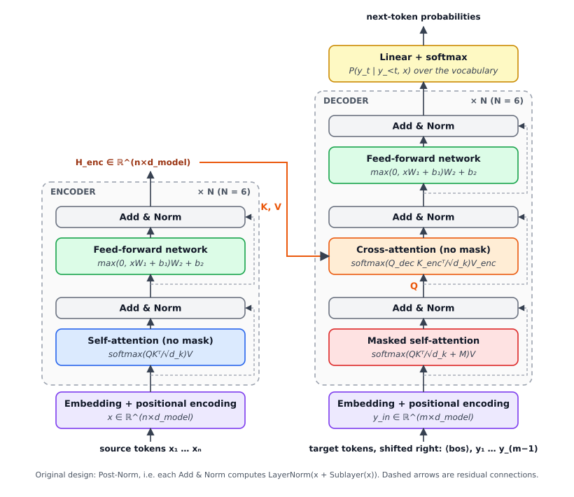
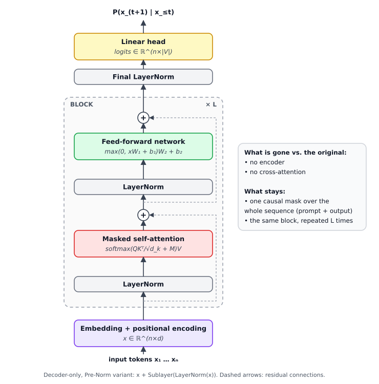

This is Part 5, the second of four articles on attention. [Part 4](../04-attention-scaled-dot-product/index.qmd) built scaled dot-product attention:

$$
\text{Attention}(Q, K, V) = \text{softmax}\!\left(\frac{QK^\top}{\sqrt{d_k}}\right)V
$$

Here we use it in three ways, following the original Transformer paper (Vaswani et al., 2017): bidirectional self-attention, *masked* self-attention, and *cross-attention*. Then we see which parts modern LLMs kept.

## The original job: translation

The Transformer was introduced for sequence-to-sequence tasks such as machine translation. Two stacks of layers do two different jobs:

- The **encoder** reads the whole source sentence and produces one contextual vector per source token.
- The **decoder** writes the output sentence one token at a time, consulting the encoder's output as it goes.

{fig-alt="Encoder stack on the left, decoder stack on the right, with the encoder output feeding the decoder's cross-attention layer."}

A few facts from the paper that the figure encodes (Vaswani et al., 2017):

- Both stacks have $N = 6$ identical layers, and every sub-layer and embedding outputs vectors of size $d_\text{model} = 512$.
- Each sub-layer is wrapped as $\text{LayerNorm}(x + \text{Sublayer}(x))$: add the sub-layer's input back (a *residual connection*), then normalize.
- An encoder layer has two sub-layers: self-attention and a feed-forward network.
- A decoder layer has three: *masked* self-attention, cross-attention over the encoder output, and a feed-forward network.
- The input embeddings get *positional encodings* added, because attention alone has no sense of order. That is the topic of a later article.

## The encoder: every token sees every token

In encoder self-attention, queries, keys and values all come from the previous layer's output, and each position can attend to *all* positions. No mask is applied, so information flows in both directions. If you translate "the bank of the river", the encoder's vector for "bank" can use "river", which comes later in the sentence.

## The decoder, part 1: the causal mask

The decoder produces the output one token at a time, and token $t$ may depend only on tokens before it. If the decoder could peek at the answer while predicting it, training would be trivial and useless.

The fix is a **causal mask** $M$ added to the scores before the softmax:

$$
\text{MaskedAttn}(Q,K,V) = \text{softmax}\!\left(\frac{QK^\top}{\sqrt{d_k}} + M\right)V,
\qquad
M_{ij} = \begin{cases} 0 & \text{if } j \le i \quad(\text{allowed}) \\ -\infty & \text{if } j > i \quad(\text{future token}) \end{cases}
$$

Here $i$ is the query position (the row) and $j$ is the key position (the column). The paper describes this as setting to $-\infty$ the softmax inputs that correspond to illegal connections (Vaswani et al., 2017). A concrete 4-token example, with scores that are already scaled:

$$
S = \begin{pmatrix} 2&1&0&1\\ 0&2&1&0\\ 1&0&2&1\\ 0&1&1&2 \end{pmatrix}
\qquad
S + M = \begin{pmatrix} 2&-\infty&-\infty&-\infty\\ 0&2&-\infty&-\infty\\ 1&0&2&-\infty\\ 0&1&1&2 \end{pmatrix}
$$

$$
\text{softmax}(S + M) \approx \begin{pmatrix} 1&0&0&0\\ 0.119&0.881&0&0\\ 0.245&0.090&0.665&0\\ 0.072&0.197&0.197&0.534 \end{pmatrix}
$$

Row $i$ is a proper probability distribution over positions $1, \dots, i$ only. The result is a *lower-triangular* attention matrix.

**Why $-\infty$ and not 0?** Adding 0 changes nothing: the score stays what it was, and the token still gets weight. In the example above, without the mask the first token would put $0.197 + 0.072 + 0.197 = 47\%$ of its attention on tokens 2, 3 and 4. Since softmax computes $e^{s}$, a score of $-\infty$ gives $e^{-\infty} = 0$ exactly, and the remaining weights renormalize to sum to 1.

```{mermaid}
flowchart LR
  A["<b>Scores</b><br/>S = QKᵀ/√d_k (n×n)"] --> B["<b>Add mask</b><br/>S + M<br/>M = −∞ above the diagonal"]
  B --> C["<b>Softmax per row</b><br/>future weights become exactly 0"]
  C --> D["<b>Weighted sum</b><br/>O = A·V"]
```

```python
import numpy as np

def softmax(z, axis=-1):
    z = z - z.max(axis=axis, keepdims=True)
    e = np.exp(z)
    return e / e.sum(axis=axis, keepdims=True)

def causal_mask(n):
    # 0 on and below the diagonal, -inf above it
    return np.triu(np.full((n, n), -np.inf), k=1)

def masked_attention(Q, K, V):
    n, d_k = Q.shape
    scores = Q @ K.T / np.sqrt(d_k) + causal_mask(n)   # add the mask BEFORE softmax
    weights = softmax(scores)
    return weights @ V, weights
```

## The decoder, part 2: teacher forcing and the right shift

During **training**, we already know the full target sentence. Instead of generating token by token, the decoder processes the *entire* target in one parallel pass, and the causal mask ensures every position still behaves as if it were generating step by step. Feeding the true previous tokens (rather than the model's own predictions) is called **teacher forcing**. It is what makes training parallel and fast.

There is a subtlety. The mask allows $j \le i$, which *includes the diagonal*: position $i$ may look at itself. If the decoder input at position $i$ were the very token $y_i$ it is supposed to predict, it could simply copy it. The paper's fix is to **offset the output embeddings by one position** (the "outputs, shifted right" at the bottom of the figure). Together, the mask and the shift guarantee that the prediction at position $i$ depends only on known outputs at positions less than $i$ (Vaswani et al., 2017).

```python
tokens = ["<bos>", "Los", "gatos", "duermen", "<eos>"]
decoder_input  = tokens[:-1]   # <bos> Los gatos duermen
decoder_target = tokens[1:]    # Los gatos duermen <eos>
```

| Position $t$ | Decoder input | Visible inputs (mask) | Target to predict |
|---|---|---|---|
| 1 | `<bos>` | `<bos>` | Los |
| 2 | Los | `<bos>`, Los | gatos |
| 3 | gatos | `<bos>`, Los, gatos | duermen |
| 4 | duermen | `<bos>`, Los, gatos, duermen | `<eos>` |

Read the table row by row: the **mask** hides everything to the right, and the **shift** makes sure the token at position $t$ is the *previous* target, not the one being predicted.

At **inference** there is no known target. The model generates one token, appends it to the input, and repeats, so the mask is implicit in the process. (During the first pass over a long prompt, all prompt tokens are processed in parallel, so the causal mask is still needed there.) One consequence of teacher forcing is that the model is trained on true prefixes but run on its own outputs; this train/test mismatch is often called *exposure bias*.

## The decoder, part 3: cross-attention

After masked self-attention, each decoder layer has a second attention sub-layer that lets the decoder "read" the source sentence. In **cross-attention**:

- The **queries** come from the decoder (the previous sub-layer's output).
- The **keys and values** come from the encoder's final output $H_\text{enc}$.
- **No causal mask** is applied: every decoder position can attend to every source position.

$$
\text{CrossAttn}(Q_\text{dec}, K_\text{enc}, V_\text{enc}) = \text{softmax}\!\left(\frac{Q_\text{dec} K_\text{enc}^\top}{\sqrt{d_k}}\right)V_\text{enc}
$$

If the source has $n$ tokens and the target so far has $m$, then $Q_\text{dec} \in \mathbb{R}^{m \times d_k}$ and $K_\text{enc}, V_\text{enc} \in \mathbb{R}^{n \times d_k}$, so the score matrix is $m \times n$: one row per output position, one column per source token. It is rectangular, unlike self-attention's square matrix.

For illustration: when a decoder is about to produce the Spanish word "gatos", we would expect cross-attention to put much of its weight on the source token "cats". That is the decoder dynamically deciding which part of the input matters for *this* output step.

The paper uses multi-head attention in exactly three ways (Vaswani et al., 2017):

| Where | Queries from | Keys and values from | Mask |
|---|---|---|---|
| Encoder self-attention | previous encoder layer | previous encoder layer | none |
| Decoder masked self-attention | previous decoder layer | previous decoder layer | causal |
| Encoder-decoder (cross) attention | previous decoder layer | final encoder output | none |

## From encoder-decoder to decoder-only

Modern LLMs such as GPT-style models, Llama, Mistral and Qwen use only the decoder, with the encoder and the cross-attention sub-layer removed.

{fig-alt="A stack of L blocks, each with LayerNorm, masked self-attention, residual addition, LayerNorm, feed-forward network and residual addition, followed by a final LayerNorm and a linear head."}

What changes:

- **One sequence, one stack.** The prompt and the continuation are a single token sequence. The same causal mask handles both: prompt tokens attend to earlier prompt tokens, and generated tokens attend to everything before them.
- **No cross-attention.** There is no separate source to read from. Everything the model knows about the input is in the same sequence it is extending.
- **One objective.** Training is plain next-token prediction on text, with every position in a sequence providing a training signal.

Commonly cited reasons for the shift are simplicity (one model, one loss), and that the pretraining objective matches how the model is used at generation time. These are explanations from later work and practice rather than claims of the original paper, and encoder-decoder models are still used, particularly for tasks with a clearly separate input and output such as translation and summarization. Cross-attention also lives on in multimodal models, where an image encoder can supply keys and values to a language decoder.

| Family | Attention pattern | Examples | Typical use |
|---|---|---|---|
| Encoder-only | bidirectional self-attention | BERT (Devlin et al., 2018) | classification, embeddings |
| Encoder-decoder | bidirectional encoder, causal decoder, cross-attention | original Transformer, T5 (Raffel et al., 2019), BART (Lewis et al., 2019) | translation, summarization |
| Decoder-only | causal self-attention | GPT-style models, Llama, Mistral, Qwen | text generation, chat |

A note on the two diagrams. The original design applies layer normalization *after* the residual addition (**Post-Norm**: $\text{LayerNorm}(x + \text{Sublayer}(x))$). Most modern decoder-only LLMs apply it *before* the sub-layer (**Pre-Norm**: $x + \text{Sublayer}(\text{LayerNorm}(x))$). Why that matters is the subject of a later article in this series.

## Common pitfalls

- **Adding the mask in the wrong place.** The mask is *added to the scores before softmax*. Multiplying the weights by 0 *after* softmax leaves rows that no longer sum to 1.
- **Forgetting the shift.** If decoder inputs are not shifted relative to the targets, position $i$ sees the token it must predict. Training loss collapses toward zero and the model produces garbage at inference, because it learned to copy.
- **Confusing padding masks with causal masks.** They solve different problems: a padding mask hides padding tokens in a batch, a causal mask hides future tokens. Real code often needs both, combined.
- **Fully masked rows.** If every entry in a row is $-\infty$, softmax computes $0/0$ and returns NaN (try `softmax(np.full((1, 3), -np.inf))`). Make sure every query has at least one allowed key, and in low-precision floats prefer the dtype's most negative finite value over a literal infinity.
- **Mixing up cross-attention sources.** Queries come from the decoder; keys and values come only from the encoder output. Swapping them changes what the layer computes.
- **Believing the mask only matters in training.** It also matters at inference whenever several tokens are processed in parallel, for example when a long prompt is first fed through the model.

## Summary

- The original Transformer has an encoder (bidirectional self-attention) and a decoder (masked self-attention, then cross-attention, then a feed-forward network).
- The causal mask adds $-\infty$ above the diagonal of the score matrix, so future positions get exactly zero weight.
- The right shift of the decoder input prevents each position from seeing its own target; the mask prevents it from seeing later ones. Together they allow parallel training with teacher forcing.
- Cross-attention takes queries from the decoder and keys and values from the encoder output, with no causal mask.
- Decoder-only LLMs keep the masked self-attention stack and drop the encoder and cross-attention.

## References

- Vaswani, A., et al. (2017). *Attention Is All You Need.* NeurIPS 2017. [arXiv:1706.03762](https://arxiv.org/abs/1706.03762).
- Devlin, J., Chang, M.-W., Lee, K., Toutanova, K. (2018). *BERT: Pre-training of Deep Bidirectional Transformers for Language Understanding.* [arXiv:1810.04805](https://arxiv.org/abs/1810.04805).
- Raffel, C., et al. (2019). *Exploring the Limits of Transfer Learning with a Unified Text-to-Text Transformer (T5).* [arXiv:1910.10683](https://arxiv.org/abs/1910.10683).
- Lewis, M., et al. (2019). *BART: Denoising Sequence-to-Sequence Pre-training for Natural Language Generation, Translation, and Comprehension.* [arXiv:1910.13461](https://arxiv.org/abs/1910.13461).
- Roitman, H. *The Hitchhiker's Guide to Agentic AI: From Foundations to Systems.* [arXiv:2606.24937](https://arxiv.org/abs/2606.24937).

---

This work adapts material from "The Hitchhiker's Guide to Agentic AI" by Haggai Roitman (arXiv:2606.24937v3, book version 1.4), licensed under CC BY-SA 4.0 (https://creativecommons.org/licenses/by-sa/4.0/). Changes: adapted into standalone articles, with added explanations, diagrams and examples. This work is licensed under CC BY-SA 4.0.
