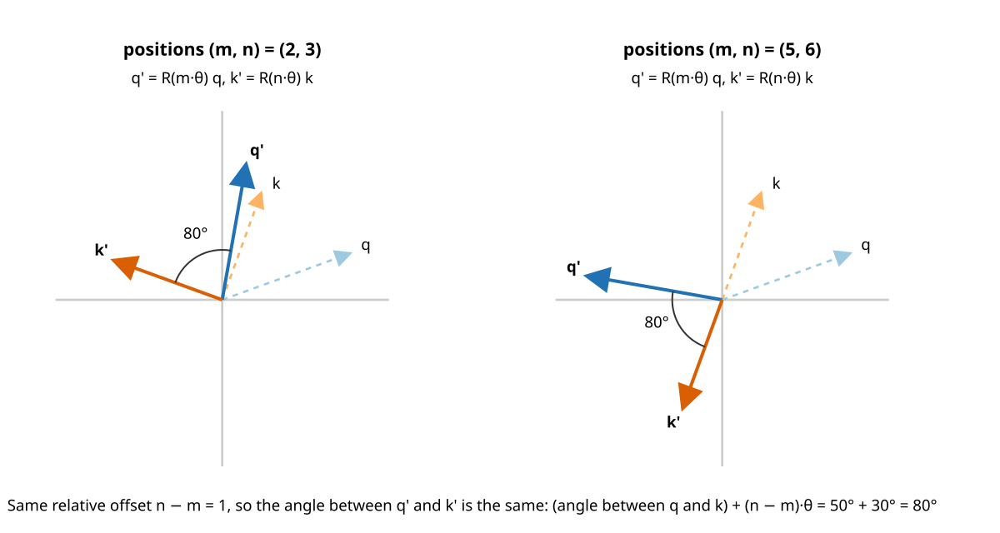

[Part 8](../08-positional-encoding-basics/index.qmd) showed why attention needs position information and covered the classic methods. Rotary Position Embedding (RoPE; Su et al., 2021, the "RoFormer" paper) is the method most modern open LLM families build on; the YaRN paper lists the LLaMA, GPT-NeoX and PaLM families as RoPE models. The idea fits in one sentence: **rotate each query and key by an angle proportional to its position, and the dot product between them then automatically depends on how far apart they are.**

## 1. The goal

Write the position-aware query and key as $f_q(x_m, m)$ and $f_k(x_n, n)$, where $x_m, x_n$ are the embeddings of the tokens at positions $m$ and $n$. We want their inner product to depend on the two contents and on the relative offset only:

$$
\langle f_q(x_m, m),\, f_k(x_n, n)\rangle = g(x_m, x_n, m-n)
$$

$g$ is just "some function of those three things". Why relative? A phrase should behave the same whether it sits at position 5 or at position 5000, and attention between two words should depend on how far apart they are, not on where in the document they happen to be.

## 2. The idea in 2D

Start with a query and a key that are 2-dimensional. The dot product of two vectors is $|a||b|\cos(\text{angle between them})$. It only cares about the lengths and the angle between the vectors.

So: **rotate** the query by $m\theta$ and the key by $n\theta$, where $\theta$ is a fixed angle. Rotations do not change lengths. The angle between the rotated vectors is the original angle plus $(n-m)\theta$. Shift both positions by the same amount and nothing changes.



In symbols, with the rotation matrix $R(\alpha) = \begin{pmatrix}\cos\alpha & -\sin\alpha\\ \sin\alpha & \cos\alpha\end{pmatrix}$:

$$
\tilde q_m = R(m\theta)\,W_q x_m, \qquad
\tilde k_n = R(n\theta)\,W_k x_n 
$$

$W_q, W_k$ are the usual learned projections; $\theta$ is a fixed constant; $\tilde q_m,\tilde k_n$ are the position-encoded query and key. Their dot product is

$$
\tilde q_m^\top \tilde k_n
= (W_q x_m)^\top R(m\theta)^\top R(n\theta)\,(W_k x_n)
= (W_q x_m)^\top R\big((n-m)\theta\big)\,(W_k x_n)
$$

The middle step uses two facts about rotations: $R(\alpha)^\top = R(-\alpha)$ and $R(\alpha)R(\beta) = R(\alpha+\beta)$. The absolute positions $m$ and $n$ have disappeared; only $n-m$ survives.

The RoFormer paper derives this as a solution of the requirement in Section 1, using complex numbers. The full derivation, including the assumptions it makes, is on the [companion page](rope-derivation.qmd).

## 3. From 2D to $d$ dimensions

Real queries have $d$ dimensions (the head dimension, often 64 or 128). RoPE splits them into $d/2$ pairs $(x^{(1)},x^{(2)}), (x^{(3)},x^{(4)}),\dots$ and rotates each pair as its own 2D plane, **each with its own angle**:

$$
\theta_i = 10000^{-2i/d}, \qquad i = 0, 1, \dots, \tfrac d2 - 1 
$$

(The paper indexes $i$ from 1 and writes $10000^{-2(i-1)/d}$; it is the same set of values.) At position $m$ pair $i$ is rotated by $m\theta_i$. As a matrix, this is block-diagonal:

$$
R^d_{\Theta,m} = \begin{pmatrix}
R(m\theta_0) & & \\
& R(m\theta_1) & \\
& & \ddots
\end{pmatrix},
\qquad
\tilde q_m^\top \tilde k_n = x_m^\top W_q^\top\, R^d_{\Theta,\,n-m}\, W_k x_n 
$$

Because each block is a rotation, $R^d_{\Theta,m}$ is orthogonal: it preserves the norm of $q$ and $k$, so RoPE does not change the scale of the scores. It adds no parameters. $d$ must be even.

**Efficient form.** Building the full matrix wastes work because it is mostly zeros. Rotating a pair $(a,b)$ by $\alpha$ gives $(a\cos\alpha - b\sin\alpha,\ a\sin\alpha + b\cos\alpha)$, which is $(a,b)\cos\alpha + (-b,a)\sin\alpha$. For the whole vector:

$$
R^d_{\Theta,m}\,x = x \odot \begin{pmatrix}\cos m\theta_0\\ \cos m\theta_0\\ \cos m\theta_1\\ \cos m\theta_1\\ \vdots\end{pmatrix}
+ \begin{pmatrix}-x^{(2)}\\ x^{(1)}\\ -x^{(4)}\\ x^{(3)}\\ \vdots\end{pmatrix} \odot \begin{pmatrix}\sin m\theta_0\\ \sin m\theta_0\\ \sin m\theta_1\\ \sin m\theta_1\\ \vdots\end{pmatrix}
$$

where $\odot$ is element-wise multiplication. This is a couple of element-wise operations on $x$, with the cos and sin tables computed once.

## 4. Where RoPE is applied, and why only there

```{mermaid}
flowchart LR
  X["<b>Token embedding</b><br/>xₘ"] --> Q["<b>Query</b><br/>W_q xₘ"] --> RQ["<b>Rotate by position</b><br/>q̃ₘ = R_{Θ,m} W_q xₘ"]
  X --> K["<b>Key</b><br/>W_k xₘ"] --> RK["<b>Rotate by position</b><br/>k̃ₘ = R_{Θ,m} W_k xₘ"]
  X --> V["<b>Value</b><br/>vₘ = W_v xₘ<br/>(not rotated)"]
  RQ --> S["<b>Scores</b><br/>q̃ₘᵀ k̃ₙ / √d"]
  RK --> S
  S --> O["<b>Output</b><br/>oₘ = Σₙ aₘₙ vₙ"]
  V --> O
```

RoPE rotates the **query and key only**, **after** their projections, **inside every attention layer**. Three reasons:

1. **It must act right before the dot product.** The collapse to $R_{n-m}$ needs the rotations to sit directly between $W_q x_m$ and $W_k x_n$. If you rotated the input embedding instead, you would get $x_m^\top R_m^\top W_q^\top W_k R_n x_n$, and because $W_q^\top W_k$ does not generally commute with a rotation, no relative-only form comes out.
2. **Values do not take part in the score.** Position should decide *how much* token $n$ contributes to token $m$ (the weight $a_{mn}$), not rotate *what* it contributes. If $v_n$ were rotated by its absolute position, the layer's output would pick up absolute-position dependence, which works against the relative-only design. In the RoFormer paper the values stay as $W_v x_n$.
3. **Every layer gets fresh position information.** Additive encodings enter once at the input and have to survive through all the layers. RoPE re-applies the rotation to the new $q$ and $k$ in each layer.

## 5. What do the different frequencies do?

Pair $i$ rotates by $\theta_i$ radians per token, so it completes a full turn every $\lambda_i = 2\pi/\theta_i = 2\pi\cdot 10000^{2i/d}$ tokens. These are the same geometric frequencies as the sinusoidal encoding of Part 1, now applied by rotation to $q$ and $k$. For a head dimension $d=128$:

- pair $0$ turns every $2\pi\approx 6.3$ tokens (about one radian per token);
- pair $63$ (the slowest) turns every $\approx 54{,}000$ tokens.

Think of the hands of a clock. Fast pairs tell nearby offsets apart precisely, but they wrap around, so at long range a fast pair's angle is ambiguous. Slow pairs barely move across a few tokens, but their angle changes steadily over thousands of tokens, which gives a coarse sense of large distances. Part 3 builds on this: extending context windows is mostly about what to do with the slow pairs.

## 6. Long-term decay: what the paper claims, precisely

The paper states that with $\theta_i = 10000^{-2i/d}$ the inner product has a **long-term decay**: the dependence between tokens shrinks as their relative distance grows. The argument bounds the score by an expression involving $\frac{2}{d}\sum_j |S_j|$, where $S_j=\sum_{l<j}e^{\mathrm{i}(m-n)\theta_l}$ is a sum of unit complex numbers rotating at the pair frequencies. The paper then shows numerically that this average shrinks (with oscillations) as $|m-n|$ grows.

Two honest qualifiers. This is a bound on a *proxy*, not a statement that every attention weight decays with distance. A model can learn to concentrate its query and key energy in slow pairs and attend far away. And the paper's own limitations section says the authors do not have a faithful explanation for why RoPE converges faster, or does better on long texts, than the baselines. Details and our own plot of the proxy are on the [companion page](rope-derivation.qmd).

## 7. Compatibility with linear attention

Standard attention computes all $N^2$ query-key scores. *Linear attention* (Katharopoulos et al., 2020) replaces $\exp(q^\top k/\sqrt d)$ by a kernel $\phi(q)^\top\varphi(k)$ with non-negative feature maps $\phi,\varphi$. Then the sum $\sum_n \varphi(k_n)v_n^\top$ can be computed once and reused for every query, giving $O(N)$ cost.

Additive position encodings and relative biases put position *inside the pairwise score*, which does not factor into a separate function of $q$ and of $k$. RoPE acts on each vector separately, so it still factors. The paper rotates the feature-mapped vectors:

$$
\text{Attn}(Q,K,V)_m = \frac{\sum_n \big(R^d_{\Theta,m}\phi(q_m)\big)^\top\big(R^d_{\Theta,n}\varphi(k_n)\big)\, v_n}{\sum_n \phi(q_m)^\top\varphi(k_n)} 
$$

The denominator is left **unrotated**: rotated terms can be negative, and a sum of mixed-sign terms could hit zero. The numerator can then contain negative terms, so the weights are not strictly probabilities, but the paper argues they still model importance. The paper demonstrates this with a Performer (a linear-attention transformer) on enwik8, where adding RoPE lowered the training loss.

## 8. Code

```python
import numpy as np

def rope_freqs(d, base=10000.0):
    return base ** (-2.0 * np.arange(d // 2) / d)            # theta_i

def apply_rope(x, positions, base=10000.0):
    """x: (L, d), d even, interleaved pairs (x0,x1), (x2,x3), ...
    positions: (L,) integer positions."""
    L, d = x.shape
    ang = np.outer(positions, rope_freqs(d, base))           # (L, d/2): m * theta_i
    cos = np.repeat(np.cos(ang), 2, axis=1)                  # (L, d)
    sin = np.repeat(np.sin(ang), 2, axis=1)
    rot = np.empty_like(x)
    rot[:, 0::2], rot[:, 1::2] = -x[:, 1::2], x[:, 0::2]     # (-x2, x1, -x4, x3, ...)
    return x * cos + rot * sin

def rope_matrix(m, d, base=10000.0):                         # slow reference version
    R = np.zeros((d, d))
    for i, th in enumerate(rope_freqs(d, base)):
        c, s = np.cos(m * th), np.sin(m * th)
        R[2*i:2*i+2, 2*i:2*i+2] = [[c, -s], [s, c]]
    return R

rng = np.random.default_rng(0)
d = 16
q, k = rng.normal(size=d), rng.normal(size=d)

# 1) the efficient form equals the matrix form
print(np.abs(apply_rope(q[None], [7])[0] - rope_matrix(7, d) @ q).max())   # ~0

# 2) the score depends only on the offset n - m
score = lambda m, n: apply_rope(q[None], [m])[0] @ apply_rope(k[None], [n])[0]
print(score(3, 10), score(103, 110), score(1003, 1010))                   # all equal
print(score(3, 10), score(3, 11))                                         # different offset

# 3) norms are preserved
print(np.linalg.norm(q), np.linalg.norm(apply_rope(q[None], [500])[0]))

# 4) caching rotated keys works: each key is rotated once, by its own position
K = rng.normal(size=(6, d)); Q = rng.normal(size=(6, d))
K_cached = apply_rope(K, np.arange(6))
full = apply_rope(Q, np.arange(6)) @ K_cached.T
step = apply_rope(Q[5:6], [5]) @ K_cached.T                                 # new token only
print(np.abs(full[5] - step[0]).max())                                      # ~0
```

**KV cache.** During generation, the keys of past tokens are cached. With plain RoPE you can cache keys *after* rotation: each key is rotated once by its own position, and a new query rotated by its own position gives the right relative score against all of them (check 4 above). One caveat appears in Part 3: methods that change the scaling as the sequence grows (dynamic scaling) require caching keys *before* rotation, because every token's rotation changes when the scale changes.

## 9. What the original evidence shows

It is worth knowing how modest the original experiments were, since RoPE's current dominance comes mainly from later large-scale use:

- WMT 2014 English-to-German translation: BLEU 27.5 for RoFormer versus 27.3 for the Transformer-base baseline.
- BERT-style pre-training with RoPE in place of the position encoding: faster convergence of the masked-language-model loss.
- GLUE fine-tuning: better on three of six tasks (MRPC, STS-B, QQP), worse on the other three (SST-2, QNLI, MNLI).
- Chinese long documents (CAIL2019-SCM): accuracy improves when the input length goes from 512 to 1024 characters.

## Common pitfalls

- **Interleaved versus split-half pairing.** Some code pairs dimensions $(2i, 2i+1)$ (as above); other code pairs $(i, i+d/2)$ and uses a "rotate half" trick. Both are valid *if used consistently* (they differ by a fixed permutation of dimensions), but pretrained weights assume one layout. Loading weights with the wrong convention silently wrecks the model.
- **Rotating $V$ or the raw embeddings.** Only $q$ and $k$, and after the projections.
- **Rotating $q$ and $k$ in different directions or with different bases.** The relative-position identity needs the same rotation convention for both.
- **Odd head dimension.** RoPE pairs dimensions, so $d$ must be even.
- **Low-precision angles.** At large positions $m\theta_i$ is a large number and the cos and sin tables lose accuracy in float16 or bfloat16. A common practice is to compute the angles in float32.
- **"Relative" does not mean "extrapolates."** Plain RoPE still fails beyond the training length. The slow pairs never complete a full rotation within the training length, and the YaRN authors argue that this lets them act as absolute position markers; this is the observation that motivates Part 3.
- **Mixing up the sign convention** ($m-n$ versus $n-m$) when comparing formulas across papers. It only flips the direction of rotation.

## References

- Su, Lu, Pan, Murtadha, Wen, Liu (2021). *RoFormer: Enhanced Transformer with Rotary Position Embedding.* arXiv:2104.09864.
- Vaswani et al. (2017). *Attention Is All You Need.* arXiv:1706.03762.
- Katharopoulos, Vyas, Pappas, Fleuret (2020). *Transformers are RNNs: Fast Autoregressive Transformers with Linear Attention.* arXiv:2006.16236.
- Choromanski et al. (2020). *Rethinking Attention with Performers.* arXiv:2009.14794.
- Peng, Quesnelle, Fan, Shippole (2023). *YaRN: Efficient Context Window Extension of Large Language Models.* arXiv:2309.00071.

---

This work adapts material from "The Hitchhiker's Guide to Agentic AI" by Haggai Roitman (arXiv:2606.24937v3, book version 1.4), licensed under CC BY-SA 4.0 (https://creativecommons.org/licenses/by-sa/4.0/). Changes: adapted into standalone articles, with added explanations, diagrams and examples. This work is licensed under CC BY-SA 4.0.
