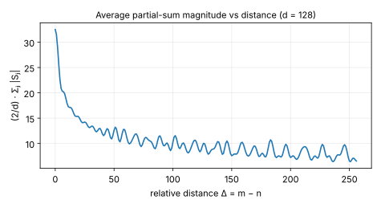

This page backs up [Part 9](index.qmd). It re-derives two results from the RoFormer paper (Su et al., 2021, Sections 3.4.1 and 3.4.3) and spells out which steps are forced and which are choices.

## 1. Setting up the 2D problem

Identify a 2D vector $(a,b)\in\mathbb{R}^2$ with the complex number $a+\mathrm{i}b$. For complex $u,v$ the usual dot product of the corresponding 2D vectors is $\mathrm{Re}(u\bar v)$, where $\bar v$ is the complex conjugate.

Let $q = W_q x_m$ and $k = W_k x_n$ be the content-only query and key (complex numbers), and let $f_q(x_m,m)$, $f_k(x_n,n)$ be the position-aware versions. We require:

- **(Initial condition)** with no position, nothing changes: $q=f_q(x_m,0)=W_q x_m$ and $k=f_k(x_n,0)=W_k x_n$.
- **(Relative-only)** the complex product $f_q(x_m,m)\,\overline{f_k(x_n,n)}$ depends on the positions only through $m-n$: it equals some function $G(x_m,x_n,m-n)$. Its real part is the dot product we care about. (Asking for the whole complex product to be relative-only is slightly stronger than asking for its real part to be, and it is what the paper does.)

Write everything in polar form, $f_q = r_q e^{\mathrm{i}\alpha_q}$, $f_k = r_k e^{\mathrm{i}\alpha_k}$, $G = r_G e^{\mathrm{i}\alpha_G}$, where $r$ is a length and $\alpha$ an angle. The product condition splits into a statement about lengths and a statement about angles:

$$
r_q(x_m,m)\,r_k(x_n,n) = r_G(x_m,x_n,m-n), \qquad
\alpha_q(x_m,m)-\alpha_k(x_n,n) = \alpha_G(x_m,x_n,m-n) \tag{1}
$$

The initial condition specifies that at position $0$, the functions reduce to the base content projections. If we express the base queries and keys in polar form as $q = \|q\|e^{\mathrm{i}\varphi_q}$ and $k = \|k\|e^{\mathrm{i}\varphi_k}$, equating them to our position-aware functions at $m=0$ and $n=0$ explicitly pins down the initial radii and angles:

$$
r_q(x_m,0) = \|q\|, \qquad r_k(x_n,0) = \|k\|
$$
$$
\alpha_q(x_m,0) = \varphi_q, \qquad \alpha_k(x_n,0) = \varphi_k \tag{2}
$$

## 2. Solving it

Set $m=n$. Then $m-n=0$, so the right-hand sides of (1) no longer depend on the position:

$$
r_q(x_m,m)\,r_k(x_n,m) = r_G(x_m,x_n,0) = r_q(x_m,0)\,r_k(x_n,0) = \|q\|\|k\|
$$
$$
\alpha_q(x_m,m)-\alpha_k(x_n,m) = \alpha_G(x_m,x_n,0) = \varphi_q-\varphi_k 
$$

**Lengths.** The first equation only fixes the product of the two radii. The simplest solution, and the one the paper takes, keeps each radius at its position-0 value: $r_q(x_m,m)=\|q\|$ and $r_k(x_n,n)=\|k\|$. This is a choice, but a natural one, because a pure rotation never changes lengths.

**Angles.** The second equation says $\alpha_q(x_m,m)-\varphi_q = \alpha_k(x_n,m)-\varphi_k$. Because the content vectors $x_m$ and $x_n$ are independent of each other, this equality demonstrates that for a fixed position $m$, the difference between the position-aware angle and the base content angle is identical for all query and key vectors, regardless of their content. We can therefore define this common, position-dependent shift as $\phi(m)$. So the position shifts every angle by the same position-only amount: $\alpha_q = \varphi_q + \phi(m)$ and $\alpha_k=\varphi_k+\phi(n)$. The initial condition gives $\phi(0)=0$.

**Pin down $\phi$.** Plug these into the angle part of (1) with $n=m-1$:

$$
\phi(m)-\phi(m-1) = \alpha_G(x_m,x_{m-1},1)-\varphi_q+\varphi_k 
$$

The right-hand side does not depend on the position $m$, so $\phi$ increases by the same constant each step. Call that constant $\theta$. An integer sequence with constant increments is an arithmetic progression, and with $\phi(0)=0$:

$$
\phi(m) = m\theta 
$$

($\theta=0$ would mean no position information at all, so $\theta\neq 0$.)

**Result.**

$$
f_q(x_m,m) = (W_q x_m)\,e^{\mathrm{i}m\theta},\qquad
f_k(x_n,n) = (W_k x_n)\,e^{\mathrm{i}n\theta},\qquad
\mathrm{Re}\!\left[f_q\overline{f_k}\right]=\mathrm{Re}\!\left[(W_qx_m)\overline{(W_kx_n)}\,e^{\mathrm{i}(m-n)\theta}\right]
$$

Multiplying by $e^{\mathrm{i}m\theta}$ is a rotation by $m\theta$, which is the matrix form used in Part 9.

**What was assumed.** This is *a* solution, not the only one: it relies on the initial condition, on the stronger complex form of the relative-only requirement, and on the choice of position-independent radii. In $d$ dimensions the paper applies the 2D solution to each of the $d/2$ pairs separately and picks the frequencies $\theta_i=10000^{-2i/d}$ following the sinusoidal encoding. That choice is motivated by tradition and by the decay property below, not derived from the requirement.

## 3. The long-term decay bound

In $d$ dimensions, group the entries of $q=W_qx_m$ and $k=W_kx_n$ into $d/2$ complex pairs $q_i,k_i\in\mathbb{C}$ ($i=0,\dots,d/2-1$). With $\Delta=m-n$, the RoPE score is

$$
\tilde q_m^\top\tilde k_n = \mathrm{Re}\Big[\sum_{i=0}^{d/2-1} h_i\,e^{\mathrm{i}\Delta\theta_i}\Big],\qquad h_i = q_i\overline{k_i}
$$

where, $q_m = f_q(x_m, m)$ and $k_n = f_k(x_n, n)$

Define the partial sums $S_j = \sum_{i=0}^{j-1}e^{\mathrm{i}\Delta\theta_i}$, and let $S_0=0$ and $h_{d/2}=0$. By simply expanding the products and regrouping the terms to shift the difference from the $S$ terms to the $h$ terms (a technique known as **Abel summation**) we get:

$$
\sum_{i=0}^{d/2-1}h_i\,(S_{i+1}-S_i) \;=\; -\sum_{i=0}^{d/2-1}S_{i+1}\,(h_{i+1}-h_i)
$$

The LHS is exactly the score sum, since $e^{\mathrm{i}\Delta\theta_i}=S_{i+1}-S_i$. Taking absolute values and using the triangle inequality:

$$
\Big|\sum_i h_i e^{\mathrm{i}\Delta\theta_i}\Big|
\le \sum_i |S_{i+1}|\,|h_{i+1}-h_i|
\le \Big(\max_i |h_{i+1}-h_i|\Big)\sum_{i=0}^{d/2-1}|S_{i+1}| 
$$

So the score is bounded by (how much the pair products $h_i$ vary from pair to pair) times $\sum_j|S_j|$. The first factor depends on the particular $q$ and $k$. The second depends only on the distance $\Delta$ and the frequencies. The paper's claim is that the average $\frac{2}{d}\sum_j|S_j|$ shrinks as $|\Delta|$ grows when $\theta_i=10000^{-2i/d}$, and it shows this in a plot.

### 3.1 Why the Bound Shrinks with Distance

At $\Delta=0$, all terms $e^{\mathrm{i}\Delta\theta_i}$ equal $1$. This means the partial sums are simply $|S_j|=j$, and their average across all dimensions is exactly $(d/2+1)/2$. 

To understand why this average drops as $\Delta$ grows, shift perspective and treat $\theta$ as a continuous variable, looking at the terms $e^{\mathrm{i}\Delta\theta}$. In this $\theta$-space, the function oscillates with a period of $2\pi/\Delta$. 

The base frequencies $\theta_i = 10000^{-2i/d}$ span a range from $1$ down to $0.0001$. As the relative distance $\Delta$ increases, the period $2\pi/\Delta$ shrinks rapidly. This forces the function to oscillate many times across the available $\theta$ range. When you sum over these highly oscillatory complex values, the vectors point in all different directions around the unit circle and largely cancel each other out through destructive interference.

However, this is an intuitive heuristic rather than a conclusive mathematical proof. If this were a continuous integration over a uniform range ($\int e^{\mathrm{i}\Delta\theta} d\theta$), the cancellations would be clean and the value would decay smoothly toward zero. But RoPE computes a discrete sum over exponentially spaced points. This non-uniform sampling means the cancellation is imperfect, which is probably why the sum doesn't perfectly decay to zero, but instead hits a messy, oscillating plateau.

Here is our plot of the average for $d=128$:

### 3.2 Caveats and What the Bound Actually Means

This result describes a trend in an upper bound, not a strict guarantee about actual attention scores. When interpreting this decay, keep three limitations in mind:

- **The bound is data-dependent.** The upper bound is a product of the distance factor $\sum_i |S_{i+1}|$ and a content-dependent factor $\max_i |h_{i+1}-h_i|$, which is governed by the input tokens and the learned weights $W_q, W_k$. If the pairwise products $h_i$ vary sharply from one pair to the next, that maximum difference can easily overpower the shrinking distance factor.
- **The plateau never reaches zero.** Like the plot showed, the distance term drops from $32.5$ down to a floor of roughly $6.4$ to $11.6$, and then just oscillates. Because the bound never asymptotes to $0$, RoPE inherently cannot force distant tokens to have a zero attention score. It only applies a mild, structural suppression.
- **Trained models can concentrate energy in the slow pairs.** Because different dimension pairs rotate at vastly different speeds, a trained model can bypass the decay entirely by routing long-range information into the slowest-rotating dimensions.

### 3.3 How Models Bypass Decay: Concentrating Energy in Slow Pairs

To see how a model circumvents the decay bound in practice, look at how the full $d$-dimensional dot product is assembled from individual 2D pairs. 

RoPE partitions the $d$ coordinates of $q = W_q x_m$ and $k = W_k x_n$ into $d/2$ disjoint 2D pairs: $(0,1), (2,3), \dots, (d-2, d-1)$. Let $q^{(i)}, k^{(i)} \in \mathbb{R}^2$ be the $i$-th pair before rotation, with lengths $\|q^{(i)}\|, \|k^{(i)}\|$ and an initial content angle $\psi_i = \varphi_q^{(i)} - \varphi_k^{(i)}$ between them. 

When RoPE rotates $q^{(i)}$ by $m\theta_i$ and $k^{(i)}$ by $n\theta_i$, their lengths stay fixed while the angle between them shifts by $(m-n)\theta_i = \Delta\theta_i$. Summing the standard 2D dot products across all $d/2$ pairs gives the full RoPE attention score:

$$
\tilde{q}_m^\top \tilde{k}_n = \sum_{i=0}^{d/2-1} \|q^{(i)}\| \|k^{(i)}\| \cos(\psi_i + \Delta\theta_i)
$$

Each term in this sum has two distinct components:

1. **The pair magnitude $\|q^{(i)}\| \|k^{(i)}\|$ ("energy"):** How large the numbers are in pair $i$. This acts as a volume knob controlling how much pair $i$ contributes to the total attention score, and it is controlled entirely by rows $2i$ and $2i+1$ of the learned matrices $W_q$ and $W_k$.
2. **The rotation factor $\cos(\psi_i + \Delta\theta_i)$:** How aligned the pair remains after being twisted across distance $\Delta$ at frequency $\theta_i = 10000^{-2i/d}$.

Because $\theta_i$ decays exponentially with $i$, the early pairs and late pairs behave completely differently over long distances:

- **Fast pairs (small $i$):** Pair $i=0$ has $\theta_0 = 1\text{ rad/token}$ ($\approx 57.3^\circ\text{/token}$), completing a full rotation every $\lambda_0 = 2\pi \approx 6.28$ tokens. Over long distances like $\Delta = 2000$, $\cos(\Delta\theta_0)$ oscillates wildly between $+1$ and $-1$, turning the pair's contribution into high-frequency noise.
- **Slow pairs (large $i$):** A late pair with a wavelength of $\lambda_i = 60,000$ tokens has $\theta_i = 2\pi / 60,000$. Even across a distance of $\Delta = 2000$ tokens, the vector rotates by only $\Delta\theta_i = \pi/15\text{ rad} = 12^\circ$. Since $\cos(12^\circ) \approx 0.978$, nearly $98\%$ of the aligned dot product survives intact.

#### 3.3.1 A Concrete $d=4$ Example

Suppose $d=4$, giving just two pairs: Pair $0$ (fast) and Pair $1$ (slow, with $\Delta\theta_1 = 12^\circ$ at $\Delta = 2000$). Suppose a pronoun at position $m=2000$ needs to attend strongly to a noun at $n=0$ ($\Delta = 2000$), and the content projections are perfectly aligned in both pairs ($\psi_0 = \psi_1 = 0$).

- **Case A (Equal energy across pairs):** Suppose $W_q$ and $W_k$ assign unit length to both pairs, $q = k = [1, 0, \; 1, 0]$. Both pairs have $\|q^{(i)}\|\|k^{(i)}\| = 1$, and the unrotated dot product ($\Delta=0$) is $1 + 1 = 2$. At $\Delta = 2000$, the fast pair spins to some arbitrary value—say $\cos(2000\theta_0) \approx -0.8$—while the slow pair stays near $\cos(12^\circ) \approx 0.98$. The total score drops to:
  $$
  \tilde{q}_m^\top \tilde{k}_n = (1 \times -0.8) + (1 \times 0.98) = 0.18
  $$
- **Case B (Energy concentrated in the slow pair):** During training, gradient descent is penalized if the model fails to connect the pronoun to the distant noun. To prevent the fast pair from corrupting the long-range score, the optimizer can update $W_q$ and $W_k$ to zero out rows $0,1$ and scale up rows $2,3$, producing $q = k = [0, 0, \; \sqrt{2}, 0]$. The total vector norm is unchanged ($\|q\| = \|k\| = \sqrt{2}$), and the $\Delta=0$ score is still $2$. Now, at $\Delta = 2000$, the fast pair's wild rotation is multiplied by zero magnitude, while the slow pair carries all the weight:
  $$
  \tilde{q}_m^\top \tilde{k}_n = (0 \times -0.8) + (2 \times 0.98) = 1.96
  $$

In terms of the Abel summation bound, setting $h_0 = 0$ and $h_1 = 2$ eliminates the cancellation between pairs and inflates the data-dependent factor $\max_i |h_{i+1}-h_i|$. In practice, trained transformers naturally learn this division of labor: they use fast-rotating pairs to attend to local syntax and immediate neighbors, while routing long-range semantic dependencies into slow-rotating pairs where RoPE's decay is too weak to erase them.

As the RoFormer authors note in their limitations section, while the decay bound provides useful intuition for why uniformly distributed features fade with distance, there is still no complete theoretical explanation for why RoPE empirically outperforms other position encodings on long texts.

**How to read this.** It is a trend in an upper bound, not a guarantee about actual attention. The bound has a data-dependent factor ($|h_{i+1}-h_i|$), the plateau does not go to zero, and a trained model can put its query and key energy in the slow pairs (small $\theta_i$) where this decay is weak. The paper's limitations section also notes that the authors have no faithful explanation of why RoPE does better on long texts than other methods.

## References

- Su, Lu, Pan, Murtadha, Wen, Liu (2021). *RoFormer: Enhanced Transformer with Rotary Position Embedding.* arXiv:2104.09864, Sections 3.4.1 and 3.4.3.

---

This page is licensed under CC BY-SA 4.0 (https://creativecommons.org/licenses/by-sa/4.0/).
