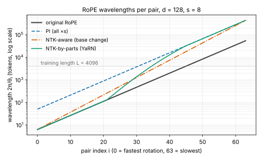

A model trained on 4,096-token sequences is asked to read 32,000 tokens. [Part 9](../09-rope-rotary-position-embedding/index.qmd) showed that RoPE is *relative*, so you might hope this just works. It does not. This article explains why, and walks through the main fixes: position interpolation (PI), NTK-aware scaling, dynamic scaling, NTK-by-parts and YaRN. It then covers what else a long-context model needs, and why a big context window does not guarantee the model uses it well.

## 1. Why plain RoPE fails beyond the training length

Recall from Part 9 that pair $i$ of a query or key is rotated by $m\theta_i$ at position $m$, with $\theta_i = 10000^{-2i/d}$ and $i=0,\dots,d/2-1$. Its **wavelength** is $\lambda_i = 2\pi/\theta_i$, the number of tokens per full turn. Let $L$ be the training length.

- **Fast pairs** ($\lambda_i \ll L$) complete many turns during training, so they have seen every angle many times. Positions beyond $L$ just revisit familiar angles.
- **Slow pairs** ($\lambda_i > L$) never complete a turn during training. They have only ever seen a *partial arc* of angles. Beyond position $L$ they enter angles the network has never encountered.

For a head dimension $d=128$ and $L=4096$, $18$ of the $64$ pairs are slow in this sense. The YaRN authors point out that this makes RoPE less purely "relative" than it looks: a slow pair behaves like an absolute position marker within the training range, and out-of-range values are out of distribution. The position interpolation paper describes the symptom: direct extrapolation can produce catastrophically large attention scores that ruin self-attention.

Notation used below: $L$ is the training length, $L'>L$ the target length, and $s = L'/L$ the **scale factor**. $\theta_i$ and $\lambda_i=2\pi/\theta_i$ are as above, and $b=10000$ is the base of $\theta_i = b^{-2i/d}$.



## 2. The methods

```{mermaid}
flowchart LR
  A["<b>RoPE</b><br/>θᵢ = b^(−2i/d)"] --> B["<b>Position interpolation</b><br/>m → m / s"]
  B --> C["<b>NTK-aware</b><br/>b → b · s^(d/(d−2))"]
  C --> D["<b>Dynamic scaling</b><br/>s = max(1, l′/L)"]
  C --> E["<b>NTK-by-parts</b><br/>blend θᵢ and θᵢ/s per pair"]
  E --> F["<b>YaRN</b><br/>NTK-by-parts + attention scale"]
```

All of them modify the angle $m\theta_i$ that pair $i$ is rotated by. In the YaRN paper's unified notation, a method replaces the position $m$ by some $g(m)$ and the frequencies $\theta_i$ by some $h(\theta_i)$.

### Position interpolation (PI)

Chen et al. (2023) (and concurrently the blogger kaiokendev) squeeze the new, longer range of positions back into the trained range:

$$
m \;\to\; \frac{m}{s} = \frac{mL}{L'} .
$$

Equivalently, every $\theta_i$ becomes $\theta_i/s$, so **every wavelength gets $s$ times longer**. The largest position $L'$ now produces the same angles as position $L$ did in training, so no pair meets an unseen angle. The paper shows the interpolated attention score has a much smaller upper bound than the extrapolated one (about 600 times smaller in their LLaMA 7B setting) and extends LLaMA models to 32,768 tokens with fine-tuning of about 1,000 steps.

The cost: **resolution.** Adjacent tokens used to be one radian apart on the fastest pair. Now they are $1/s$ radians apart, so the fast pairs have trouble telling neighbours apart. The YaRN authors report that PI fine-tunes of that period degraded at roughly $s=8$ and above.

### NTK-aware scaling

Instead of stretching every pair equally, change the *base*: $b \to b' = b\cdot s^{\,d/(d-2)}$. Then

$$
\theta'_i = b'^{-2i/d} = \theta_i \cdot s^{-2i/(d-2)} .
$$

Check the two ends. For $i=0$ the factor is $1$: the fastest pair is untouched. For the last pair, $i=d/2-1$, the exponent is $-1$: the slowest pair is divided by exactly $s$, as in PI. In between the stretch grows smoothly. So **high frequencies (local detail) are kept and low frequencies (long range) are stretched**. This was introduced by the pseudonymous user bloc97 in a 2023 forum post (the name refers to Neural Tangent Kernel results about learning high-frequency functions; it is a heuristic motivation), and documented in the YaRN paper. Code Llama used the same idea by setting the base to 1,000,000.

Limits: the method works reasonably *without* fine-tuning, but it slightly extrapolates some pairs, so the real extension is not exactly $s$, and fine-tuning with it gave worse results than PI in the YaRN paper's analysis. The best base is usually found empirically.

### Dynamic scaling ("Dynamic NTK")

Rather than fixing $s=L'/L$ for all inputs, recompute it from the *current* length $l'$ at each forward pass:

$$
s = \max\!\left(1, \frac{l'}{L}\right).
$$

Short inputs are untouched (no loss below $L$), and the model degrades gradually when the length grows instead of failing abruptly at $L'$. It works well on models that were never fine-tuned for longer contexts. **KV-cache consequence:** since the rotation of every past token changes whenever $s$ changes, the cache must store keys *before* RoPE and apply the rotation at attention time.

### NTK-by-parts

The YaRN paper's refinement looks at each pair's *wavelength relative to the training length*. Let $r_i = L/\lambda_i$ be the number of full turns pair $i$ completes within $L$ tokens, and let $\alpha<\beta$ be two thresholds. The ramp is

$$
\gamma(r) = \begin{cases} 0 & r<\alpha \\ \dfrac{r-\alpha}{\beta-\alpha} & \alpha\le r\le\beta \\ 1 & r>\beta \end{cases},
\qquad
h(\theta_i) = \big(1-\gamma(r_i)\big)\frac{\theta_i}{s} + \gamma(r_i)\,\theta_i .
$$

- Pairs with $r_i<\alpha$ (slow, they never complete a turn) are **fully interpolated** like PI, so they never extrapolate.
- Pairs with $r_i>\beta$ (fast) are **left alone**, preserving fine local resolution.
- Pairs in between are blended.

The paper found $\alpha=1$ and $\beta=32$ work well for the Llama family; they are tuned per model family. In our $d=128$, $L=4096$ example: $18$ pairs are fully interpolated, $21$ are untouched and $25$ are blended.

### YaRN

YaRN ("Yet another RoPE extensioN") is NTK-by-parts **plus an attention temperature**. A longer context means more keys in each softmax, which flattens it (higher entropy). Dividing the logits by a temperature $t<1$ re-sharpens them. The paper recommends, for the LLaMA and Llama 2 families,

$$
\sqrt{\frac1t} = 0.1\ln(s) + 1,
$$

found by fitting the best-perplexity value across several scale factors without fine-tuning. It is implemented for free by multiplying both $q$ and $k$ by $\sqrt{1/t}$, which is the same as scaling the precomputed RoPE cos and sin tables, so the attention code is unchanged and there is no run-time overhead. For $s=8$: $\sqrt{1/t}\approx 1.208$, so the logits (a product of one scaled $q$ and one scaled $k$) are multiplied by about $1.46$.

Reported results: state-of-the-art context extension after fine-tuning on less than about 0.1% of the original pre-training data, with 10 times fewer tokens and 2.5 times fewer steps than previous methods. Llama 2 7B and 13B were extended to 128K tokens with a few hundred fine-tuning steps ($s=16$ for 400 steps on 64K-token data, then $s=32$ for 200 more).

### Summary

| Method | What changes | Fine-tuning | Notes |
|---|---|---|---|
| PI | all $\theta_i \to \theta_i/s$ | needed | simple; loses fast-pair resolution |
| NTK-aware | base $b\to b\,s^{d/(d-2)}$ | optional | stretches slow pairs more; slight extrapolation |
| Dynamic NTK | $s$ follows the current length | none | cache keys before rotation |
| NTK-by-parts | per-pair blend of $\theta_i$ and $\theta_i/s$ | helps | needs $\alpha,\beta$ |
| YaRN | NTK-by-parts plus attention scale | small amount | scale $0.1\ln s+1$ tuned on LLaMA-family models |

## 3. Code

```python
import numpy as np

def rope_freqs(d, base=10000.0):
    return base ** (-2.0 * np.arange(d // 2) / d)

def pi_freqs(d, s, base=10000.0):
    return rope_freqs(d, base) / s                          # all pairs stretched by s

def ntk_aware_freqs(d, s, base=10000.0):
    return rope_freqs(d, base * s ** (d / (d - 2)))         # change of base

def ntk_by_parts_freqs(d, s, L, alpha=1.0, beta=32.0, base=10000.0):
    th = rope_freqs(d, base)
    r = L / (2 * np.pi / th)                                # turns completed within L tokens
    gamma = np.clip((r - alpha) / (beta - alpha), 0.0, 1.0) # 0: interpolate, 1: keep
    return (1 - gamma) * th / s + gamma * th

def yarn_scale(s):
    return 0.1 * np.log(s) + 1.0        # = 1/sqrt(t): multiply both q and k by this

d, L, s = 128, 4096, 8
orig = 2 * np.pi / rope_freqs(d)
for name, f in [("PI", pi_freqs(d, s)),
                ("NTK-aware", ntk_aware_freqs(d, s)),
                ("NTK-by-parts", ntk_by_parts_freqs(d, s, L))]:
    w = 2 * np.pi / f
    print(name, "wavelength ratio, fastest/slowest pair:", w[0] / orig[0], w[-1] / orig[-1])
# PI: 8, 8   NTK-aware: 1, 8   NTK-by-parts: 1, 8
print("pairs that never complete a turn in L:", int((orig > L).sum()), "of", d // 2)   # 18 of 64
```

To use any of these, pass the modified frequencies to the RoPE function from Part 9 (replace `rope_freqs(d, base)` by the modified array) and, for YaRN, multiply the rotated $q$ and $k$ by `yarn_scale(s)`.

## 4. What else a long-context model needs

**Continued training on long data.** Adjusting the angles only makes long positions *legal*. The model still has to learn to use them. The Llama 3 report describes raising the RoPE base frequency to 500,000 and a long-context pre-training stage that increased the context in six stages from 8K to 128K tokens, using about 800B tokens. Fine-tuning recipes such as PI and YaRN are far lighter (hundreds to about a thousand steps) but are working from an already-trained model.

**Perplexity is not the whole story.** In the YaRN paper's passkey-retrieval test (find a five-digit number hidden in a long filler text), a model whose perplexity was already rising beyond 100K tokens still retrieved the passkey at 128K. The authors conclude that the lowest perplexity point does not describe the effective context size.

**Systems techniques (intuition only).** *Ring Attention* (Liu et al., 2023) splits a very long sequence into blocks spread across devices arranged in a ring; each device keeps its block of queries and passes key-value blocks around the ring while computing attention against each block it receives, overlapping communication with compute. This makes memory per device scale with the block size rather than the full sequence and computes *exact* attention. *Hybrid architectures* use cheap local (sliding-window) attention in most layers and full attention only in some, so most of the compute scales with the window size instead of the sequence length.

## 5. Long context is not long-context use

A model that accepts 1M tokens does not necessarily use all of them. The "lost in the middle" study (Liu et al., 2023) placed the relevant passage at different positions in long inputs and found accuracy highest when it sat at the beginning or the end of the context and lowest when it was in the middle. Using long contexts well takes both positional machinery that keeps working at long range *and* training on tasks that reward retrieving from far away.

## Common pitfalls

- **Treating $s$ as the extension you actually get.** NTK-aware scaling slightly extrapolates some pairs, so you may have to set $s$ higher than $L'/L$.
- **Serving with a different scaling than the model was adapted with.** A model fine-tuned with PI, YaRN or a particular base expects exactly that frequency set at inference.
- **Leaving out YaRN's attention scale.** It is part of the method, not an optional extra, and the $0.1\ln s+1$ value was fitted on LLaMA-family models, so treat it as a starting point for other architectures.
- **Caching rotated keys under dynamic scaling.** If $s$ changes, cached rotated keys become stale. Cache keys before rotation.
- **Copying $\alpha=1,\beta=32$ blindly.** They were tuned for the Llama family.
- **Equating context length with usable context.** Check retrieval-style tests, not only perplexity, and test with the relevant information in the middle.
- **Low-precision angles.** Large positions times small frequencies need float32 for the cos and sin tables.

## References

- Chen, Wong, Chen, Tian (2023). *Extending Context Window of Large Language Models via Positional Interpolation.* arXiv:2306.15595.
- bloc97 (2023). *NTK-Aware Scaled RoPE allows LLaMA models to have extended (8k+) context size without any fine-tuning and minimal perplexity degradation.* Forum post, r/LocalLLaMA. emozilla (2023). *Dynamically Scaled RoPE further increases performance of long context LLaMA with zero fine-tuning.* Forum post, r/LocalLLaMA.
- Peng, Quesnelle, Fan, Shippole (2023). *YaRN: Efficient Context Window Extension of Large Language Models.* arXiv:2309.00071.
- Rozière et al. (2023). *Code Llama: Open Foundation Models for Code.* arXiv:2308.12950.
- Llama Team, AI @ Meta (2024). *The Llama 3 Herd of Models.* arXiv:2407.21783.
- Liu, Zaharia, Abbeel (2023). *Ring Attention with Blockwise Transformers for Near-Infinite Context.* arXiv:2310.01889.
- Liu et al. (2023). *Lost in the Middle: How Language Models Use Long Contexts.* arXiv:2307.03172.
- Su et al. (2021). *RoFormer.* arXiv:2104.09864.

---

This work adapts material from "The Hitchhiker's Guide to Agentic AI" by Haggai Roitman (arXiv:2606.24937v3, book version 1.4), licensed under CC BY-SA 4.0 (https://creativecommons.org/licenses/by-sa/4.0/). Changes: adapted into standalone articles, with added explanations, diagrams and examples. This work is licensed under CC BY-SA 4.0.
